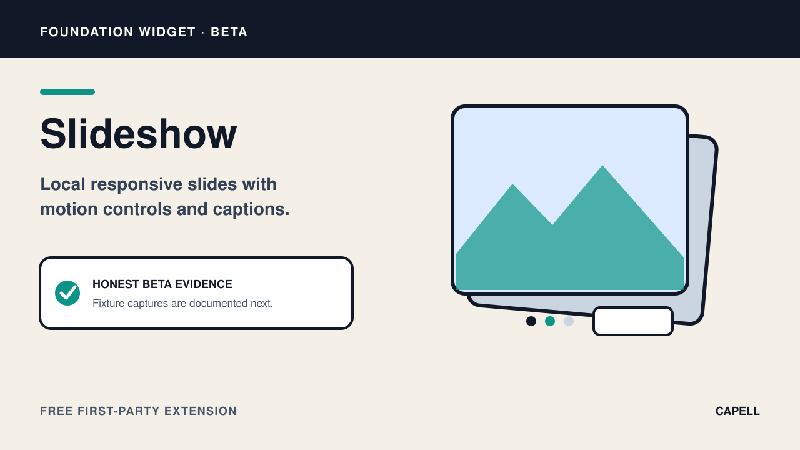
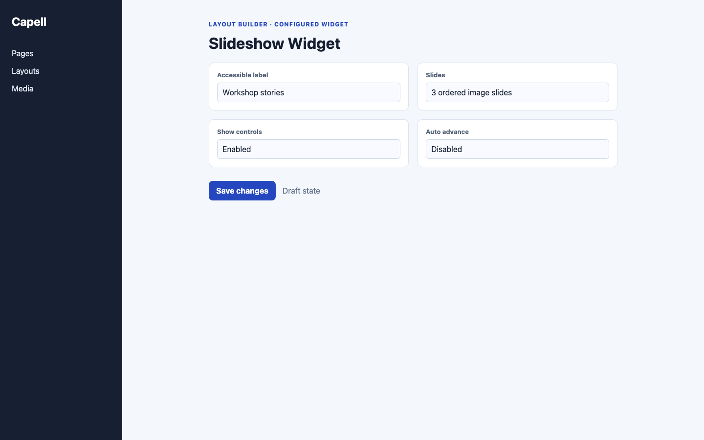

# Slideshow Widget

<!-- prettier-ignore-start -->

## What This Plugin Adds

Slideshow Widget is an **Available**, **No schema impact** Capell package in the **Capell Foundation** product group. It ships as `capell-app/widget-slideshow` and extends these surfaces: admin, frontend.

Slideshow adds a Layout Builder widget for local responsive images with captions, optional calls to action, and visitor motion controls. It rejects remote media and unsafe URLs before rendering.

Editors assemble slides in Layout Builder, and visitors receive a public image sequence with captions and controls for advancing or pausing motion.

Evidence: [`src/Filament/SlideshowWidget.php`](src/Filament/SlideshowWidget.php), [`resources/views/widget.blade.php`](resources/views/widget.blade.php), [`tests/Feature/WidgetSlideshowTest.php`](tests/Feature/WidgetSlideshowTest.php), [`capell.json`](capell.json).

Status details:

- Status: Available
- Tier: free
- Bundle: foundation
- Composer package: `capell-app/widget-slideshow`
- Namespace: `Capell\WidgetSlideshow`
- Theme key: not applicable

## Why It Matters

**For developers:** The typed extension registers its public assets and validates slide media and links while tests protect the authoring boundary.

**For teams:** Teams can publish an image sequence with useful captions and visitor-controlled motion without commissioning a custom carousel.

Evidence: [`src/Providers/WidgetSlideshowServiceProvider.php`](src/Providers/WidgetSlideshowServiceProvider.php), [`src/Filament/SlideshowWidget.php`](src/Filament/SlideshowWidget.php), [`tests/Feature/WidgetSlideshowTest.php`](tests/Feature/WidgetSlideshowTest.php), [`resources/views/widget.blade.php`](resources/views/widget.blade.php).

## Screens And Workflow

Screenshot contract: `docs/screenshots.json`.

Capture status: the Marketplace card is committed artwork; the required public-output capture is a deterministic fixture target and remains pending until the screenshot runner records an authentic installed-package result. Do not treat the existing illustrative image as release evidence.

- Slideshow Widget extension card (marketplace, required).
- Slideshow fields in Layout Builder (admin, optional).
- Slideshow public output (frontend, required capture; pending runner receipt).

## Technical Shape

- Service providers: `Capell\WidgetSlideshow\Providers\WidgetSlideshowServiceProvider`.
- Filament classes: `SlideshowWidget`.
- Data objects: `SlideshowInputData`, `SlideshowRenderData`, `SlideshowSlideData`.
- Manifest contributions: `content-widget: Capell\WidgetSlideshow\WidgetSlideshowContribution`.
- Health checks: `Capell\WidgetSlideshow\Health\WidgetSlideshowHealthCheck`.
- Blade views: `packages/widget-slideshow/resources/views/widget.blade.php`.
- Cache tags: `widget-slideshow`.

## Data Model

This package has no schema impact. It extends Capell through `content-widget` contributions instead of declaring package-owned tables.

## Install Impact

- Required packages: `capell-app/admin`, `capell-app/core`, `capell-app/frontend`, `capell-app/layout-builder`.
- Admin navigation: no admin page or resource contribution is declared.
- Admin/editor extensions: `content-widget: WidgetSlideshowContribution`.
- Permissions: none declared in `capell.json`.
- Public routes: none declared.
- Database changes: no package migrations declared.
- Config: no package config files.
- Settings: no package settings declared.
- Queues or schedules: none declared.
- Cache tags: `widget-slideshow`.
- Commands: none declared.

## Common Pitfalls

- Keep required Capell packages on compatible v4 releases: `capell-app/admin`, `capell-app/core`, `capell-app/frontend`, `capell-app/layout-builder`.
- Keep public Blade and cached HTML free of authoring markers, model IDs, permissions, signed editor URLs, and lazy database queries.
- Custom write integrations must preserve invalidation for `widget-slideshow` cache tags.

## Troubleshooting

| Symptom | Likely cause | Check | Fix |
| --- | --- | --- | --- |
| Package surface is missing after install | Provider or manifest is not loaded | Confirm `capell.json`, package `composer.json`, and provider registration | Reinstall the package, refresh Composer autoload, and clear host caches |
| Public output leaks unexpected state | Render data, cache variation, or authoring boundary has regressed | Check public Blade, cache tags, and public-output safety tests | Move data loading out of Blade and rerun the package public-output tests |

## Quick Start

1. Install the package: `composer require capell-app/widget-slideshow`.
2. No package-specific setup command or migrations are declared.
3. Open the package detail or install-intent surface and confirm the Slideshow Widget extension card is present.

## Next Steps

- [Package docs](docs/README.md)
- [Overview](docs/overview.md)
- [Troubleshooting](#troubleshooting)
- [Screenshot contract](docs/screenshots.json)
- [Marketplace assets](docs/assets/marketplace/)
- [Capell content language plan](../../docs/CONTENT_LANGUAGE_PLAN.md)
- [Capell documentation design system](../../docs/DESIGN_SYSTEM.md)
- [Capell and package ERD notes](../../docs/erd/capell-and-package-erds.md)
- Related packages: [Layout Builder](../layout-builder/README.md).
- Focused tests: `vendor/bin/pest packages/widget-slideshow/tests --configuration=phpunit.xml`.

<!-- prettier-ignore-end -->
